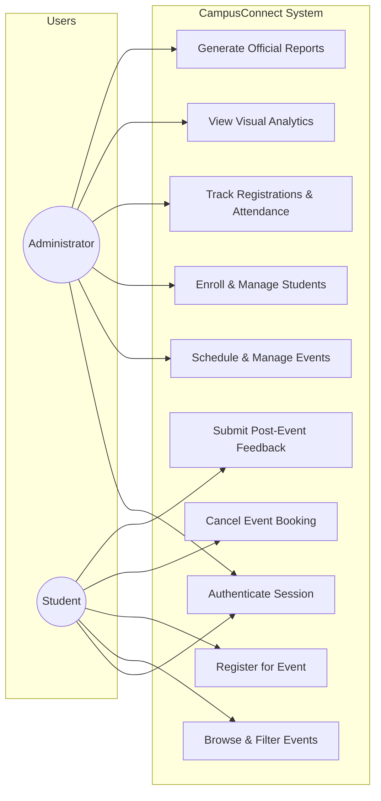
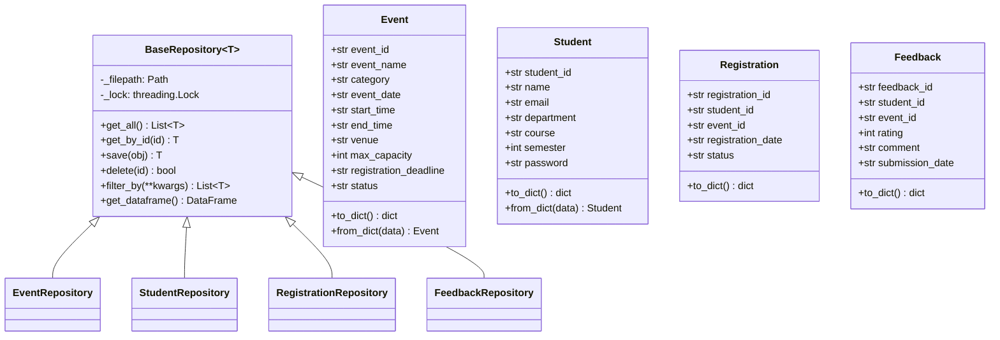
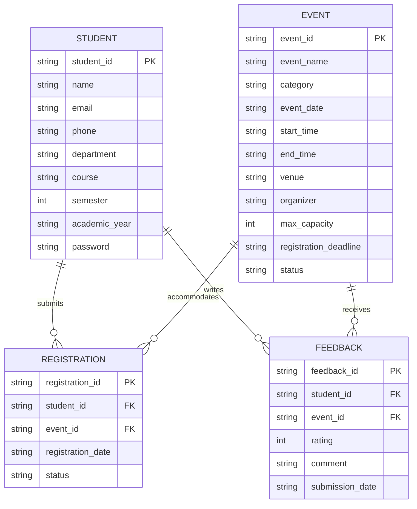
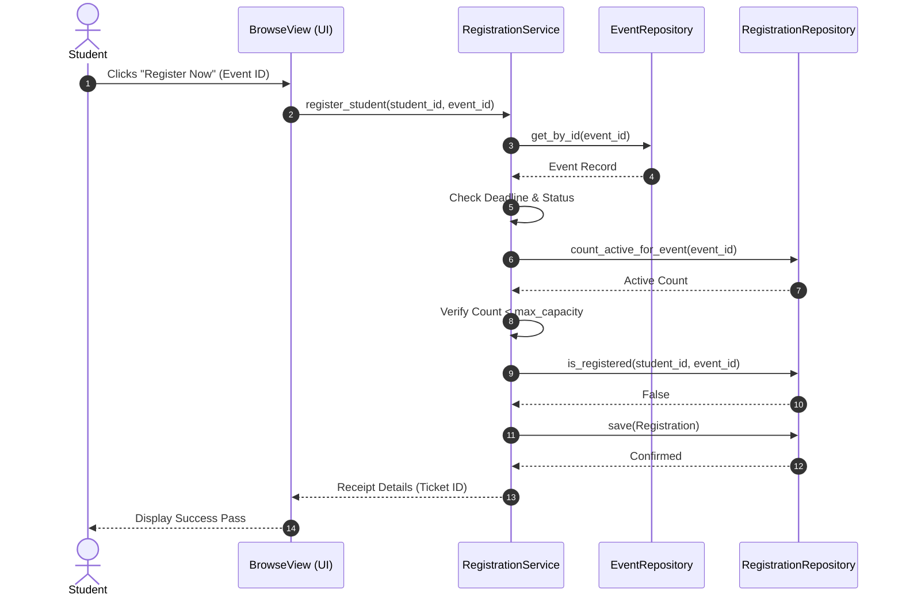

# ACADEMIC PROJECT-BASED LEARNING (PBL) REPORT

## Project Title
**Campus Event Management & Feedback Analytics System**

### Product Brand Name
**Campus Event Management & Feedback Analyzer**

### Academic Program
**Master of Computer Applications (MCA)**  
**Department of Computer Applications & Information Technology**

---

# TABLE OF CONTENTS
1. [Chapter 1 — Introduction](#chapter-1--introduction)
2. [Chapter 2 — Problem Statement](#chapter-2--problem-statement)
3. [Chapter 3 — Objectives](#chapter-3--objectives)
4. [Chapter 4 — Existing System Analysis](#chapter-4--existing-system-analysis)
5. [Chapter 5 — Proposed System Architecture](#chapter-5--proposed-system-architecture)
6. [Chapter 6 — Requirement Analysis](#chapter-6--requirement-analysis)
7. [Chapter 7 — System Design & UML Modeling](#chapter-7--system-design--uml-modeling)
8. [Chapter 8 — Layered Architecture & Design Patterns](#chapter-8--layered-architecture--design-patterns)
9. [Chapter 9 — Implementation Details](#chapter-9--implementation-details)
10. [Chapter 10 — Testing & Quality Assurance](#chapter-10--testing--quality-assurance)
11. [Chapter 11 — Results & Empirical Discussion](#chapter-11--results--empirical-discussion)
12. [Chapter 12 — Future Scope & Scalability](#chapter-12--future-scope--scalability)
13. [Chapter 13 — Conclusion](#chapter-13--conclusion)
14. [References](#references)

---

# CHAPTER 1 — INTRODUCTION

Higher education institutions operate as vibrant ecosystems where academic lectures are complemented by technical hackathons, bootcamps, workshops, cultural festivals, sports tournaments, and professional guest seminars. While extracurricular and co-curricular activities play an indispensable role in student holistic development, the logistical infrastructure coordinating these events in many universities remains fragmented, manual, or decentralized.

**Campus Event Management & Feedback Analyzer** is conceived and built as an enterprise-grade campus event management and feedback analytics platform. The application provides two distinct operational environments:
1. **Administrative Portal:** Enables university event coordinators, deans, and department heads to publish schedules, monitor seat capacities in real time, record student attendance, evaluate quantitative feedback, and inspect deep analytical trends.
2. **Student Portal:** Empowers students across departments (MCA, BCA, Computer Science, IT, Electronics, Management) to discover upcoming campus happenings, verify seat availability, register with instant confirmation passes, withdraw bookings, and submit qualitative reviews upon event completion.

By combining Python object-oriented design, the Repository Pattern, Pandas data manipulation, NumPy mathematical rigor, and Matplotlib data visualization within a Streamlit dashboard, this project demonstrates the practical application of software engineering principles to modern university administration.

---

# CHAPTER 2 — PROBLEM STATEMENT

In conventional university environments, campus event administration faces critical operational bottlenecks:

1. **Information Asymmetry & Low Visibility:** Event circulars are distributed via fragmented WhatsApp groups, notice boards, or mass emails, causing students to miss deadlines or remain unaware of relevant technical workshops.
2. **Capacity Overbooking & Lack of Controls:** Traditional Google Forms or paper sheets do not enforce real-time capacity cutoffs, leading to oversubscribed venues, safety hazards, and resource shortages.
3. **Duplicate Registrations & Inconsistent Records:** Without automated validation, students frequently register multiple times, distorting attendance forecasts.
4. **Absence of Post-Event Quality Assessment:** Universities rarely collect structured student feedback post-event. When collected, responses remain unanalyzed in spreadsheets without statistical evaluation.
5. **No Quantifiable Performance Metrics:** Organizers lack an objective metric to measure whether an event succeeded based on turnout, venue utilization, and participant satisfaction.

---

# CHAPTER 3 — OBJECTIVES

The primary technical and academic objectives of this project are:

1. **Architectural Decoupling:** Develop a clean, modular, multi-tier Python application separating the Presentation Layer (Streamlit), Application Service Layer, Domain Model Layer, and Data Access Layer.
2. **Automated Smart Registration:** Implement a deterministic 10-step verification engine that checks student identity, event existence, deadline validity, maximum seat limits, and duplicate entries.
3. **Structured Feedback Engine:** Restrict post-event reviews to verified attendees of completed events, enforcing 1–5 star ratings and preventing duplicate submissions.
4. **Empirical Data Analytics:** Utilize **Pandas** for multi-table relational joins and grouping, and **NumPy** for statistical measures (mean, median, standard deviation, variance, and interquartile range).
5. **Objective Performance Scoring:** Formulate and implement a normalized 0–100 **Event Performance Score (EPS)** combining seat utilization (40%), feedback rating (40%), and review engagement (20%).
6. **Publication-Grade Visualizations:** Develop 7 dedicated Matplotlib visualizations with exportable high-resolution graphics.
7. **Institutional Audit Reporting:** Automate one-click compilation and disk archiving of formal `.txt` and `.csv` audit ledgers.

---

# CHAPTER 4 — EXISTING SYSTEM ANALYSIS

| Operational Aspect | Existing Manual / Spreadsheets System | Proposed Campus Event Management & Feedback Analyzer System |
|---|---|---|
| **Event Scheduling** | Fragmented circulars, static PDFs, physical notice boards | Centralized real-time catalog with category, date, and venue filters |
| **Registration Mechanism** | Google Forms without real-time seat ceilings | Automated 10-step smart pipeline with real-time seat lock and instant digital pass |
| **Duplicate Prevention** | Manual deduplication in Excel post-registration | Instant programmatic rejection via custom `DuplicateRegistrationError` |
| **Capacity Management** | Manual form closures after oversubscription | Automatic status transition to `Full` once registration count matches `max_capacity` |
| **Feedback Collection** | Ad-hoc optional surveys, often unlinked to attendance | Gated review system restricted to verified attendees of completed events |
| **Data Analytics** | Basic manual spreadsheet tallies | Integrated Pandas joins and NumPy statistical calculations |
| **Institutional Reports** | Time-consuming manual report compilation | Automated one-click text audit reports and CSV data exports |

---

# CHAPTER 5 — PROPOSED SYSTEM ARCHITECTURE

Campus Event Management & Feedback Analyzer adopts a strict **Clean Layered Architecture**:

```
Presentation Layer (Streamlit: views/admin/*, views/student/*)
                    ↓ (Invocations)
Application / Service Layer (services/*.py)
                    ↓ (Coordinates)
Domain Models & Validation (models/*.py, utils/validators.py)
                    ↓ (Persistence)
Data Access Layer (repositories/base_repository.py)
                    ↓ (Thread-Safe File I/O)
Physical Storage (data/*.csv)
```

### Key Architectural Tenets:
* **Single Responsibility Principle (SRP):** Repositories solely handle I/O; services handle business workflows; views render UI components.
* **Separation of Concerns (SoC):** Domain models are pure dataclasses with no knowledge of Streamlit or CSV formats.
* **Open/Closed Principle (OCP):** New analytics or visualizations can be added without altering existing repositories or services.

---

# CHAPTER 6 — REQUIREMENT ANALYSIS

## 6.1 Functional Requirements (FR)
* **FR-01 (Authentication):** Secure role-based session login for Administrators and Students.
* **FR-02 (Event CRUD):** Admin can create, modify, cancel, and complete events with custom seat capacities and deadlines.
* **FR-03 (Student Management):** Admin can enroll students, update profiles, and inspect student engagement dossiers.
* **FR-04 (Smart Booking):** Students can register for open events if seats are available and deadlines have not passed.
* **FR-05 (Cancellation & Seat Restoration):** Students or admins can cancel active bookings, immediately restoring seat availability.
* **FR-06 (Attendance Verification):** Admin can mark confirmed attendees as `Attended` on event day.
* **FR-07 (Quality Review):** Students who attended completed events can submit 1–5 star ratings and comments.
* **FR-08 (Analytical Visualization):** Admin can view 7 Matplotlib charts covering attendance, feedback distribution, and performance metrics.
* **FR-09 (Report Generation):** System compiles and exports event performance, student rosters, and executive summaries to disk.

## 6.2 Non-Functional Requirements (NFR)
* **NFR-01 (Reliability & Robustness):** System catches all validation and domain errors without raising unhandled exceptions or crashing the UI.
* **NFR-02 (Data Integrity):** Unique constraints on Student IDs, Event IDs, and Registration pairs are strictly enforced.
* **NFR-03 (Performance):** In-memory DataFrame filtering executes in sub-second response times for typical campus workloads (thousands of records).
* **NFR-04 (Usability):** Responsive web interface with clear color-coded badges, progress meters, and confirmation feedback.

---

# CHAPTER 7 — SYSTEM DESIGN & UML MODELING

## 7.1 Use Case Diagram



## 7.2 Class Diagram



## 7.3 Entity-Relationship (ER) Diagram



## 7.4 Smart Registration Sequence Diagram



---

# CHAPTER 8 — ARCHITECTURE & DESIGN PATTERNS

## 8.1 Repository Pattern
The `BaseRepository[T]` generic class provides centralized file-locking, serialization, error catching, and query abstractions. By isolating data storage mechanics from service layers, the application ensures high testability and makes migration to relational SQL databases trivial.

## 8.2 Custom Exception Hierarchy
All application errors inherit from `CampusConnectError` (base exception class):
* `EventFullError`: Raised when bookings meet maximum capacity.
* `DuplicateRegistrationError`: Prevents multi-booking for the same event by one student.
* `RegistrationClosedError`: Triggered when an event deadline has passed or status is inactive.
* `EventNotCompletedError`: Blocks feedback submission for ongoing or future events.
* `FeedbackNotAllowedError`: Rejects reviews from students not enrolled in the event.

---

# CHAPTER 9 — IMPLEMENTATION DETAILS

## 9.1 Data Science & Numerical Stack
* **Pandas Engine:** Performs relational merges (`registrations.merge(students)`), aggregations (`groupby('department')`), and pivot calculations.
* **NumPy Statistical Module:** Computes array-based descriptive statistics on ratings arrays without external dependencies.
* **Matplotlib Engine:** Generates publication-ready figures using a customized university color palette (`#1E3A8A`, `#0D9488`, `#F59E0B`, `#EF4444`, `#10B981`).

## 9.2 Event Performance Score (EPS) Formula
The Event Performance Score (0–100) is calculated as:

$$\text{EPS} = \left( 0.40 \times S_{\text{capacity}} \right) + \left( 0.40 \times S_{\text{rating}} \right) + \left( 0.20 \times S_{\text{engagement}} \right)$$

1. **Capacity Component (40%):** $\min\left(1.0, \frac{\text{Confirmed Registrations}}{\text{Max Capacity}}\right) \times 100$
2. **Rating Component (40%):** $\left(\frac{\text{Mean Rating}}{5.0}\right) \times 100$
3. **Engagement Component (20%):** $\min\left(1.0, \frac{\text{Submitted Reviews}}{\text{Confirmed Registrations}}\right) \times 100$

---

# CHAPTER 10 — TESTING & QUALITY ASSURANCE

Automated unit tests were implemented using Python's standard `unittest` framework with isolated temporary CSV environments.

### Test Execution Summary
```text
Ran 20 tests in 0.316s
OK (All test cases passed successfully)
```

| Test Identifier | Module Under Test | Test Scenario | Expected Outcome | Result |
|---|---|---|---|---|
| **TC-EVT-01** | `test_events.py` | Create valid event | Saved with generated ID | ✅ PASS |
| **TC-EVT-02** | `test_events.py` | Duplicate Event ID | Raises `DuplicateEventError` | ✅ PASS |
| **TC-EVT-03** | `test_events.py` | Invalid date format | Raises `ValidationError` | ✅ PASS |
| **TC-EVT-04** | `test_events.py` | Capacity bounds (<1, >5000) | Raises `ValidationError` | ✅ PASS |
| **TC-STU-01** | `test_students.py` | Create valid student | Hashed password & saved | ✅ PASS |
| **TC-STU-02** | `test_students.py` | Duplicate Student ID | Raises `DuplicateStudentError` | ✅ PASS |
| **TC-STU-03** | `test_students.py` | Duplicate Email address | Raises `DuplicateStudentError` | ✅ PASS |
| **TC-STU-04** | `test_students.py` | Invalid email format | Raises `ValidationError` | ✅ PASS |
| **TC-REG-01** | `test_registrations.py` | Valid registration | Generates confirmation pass | ✅ PASS |
| **TC-REG-02** | `test_registrations.py` | Duplicate registration | Raises `DuplicateRegistrationError` | ✅ PASS |
| **TC-REG-03** | `test_registrations.py` | Booking on full event | Raises `EventFullError` | ✅ PASS |
| **TC-REG-04** | `test_registrations.py` | Non-existent student | Raises `StudentNotFoundError` | ✅ PASS |
| **TC-REG-05** | `test_registrations.py` | Non-existent event | Raises `EventNotFoundError` | ✅ PASS |
| **TC-REG-06** | `test_registrations.py` | Cancelled event registration | Raises `EventCancelledError` | ✅ PASS |
| **TC-REG-07** | `test_registrations.py` | Cancellation seat release | Seat count restored | ✅ PASS |
| **TC-FBK-01** | `test_feedback.py` | Valid review (1–5) | Persisted with rating label | ✅ PASS |
| **TC-FBK-02** | `test_feedback.py` | Rating out of bounds (<1, >5) | Raises `InvalidFeedbackError` | ✅ PASS |
| **TC-FBK-03** | `test_feedback.py` | Duplicate review by student | Raises `DuplicateFeedbackError` | ✅ PASS |
| **TC-FBK-04** | `test_feedback.py` | Review before event completed | Raises `EventNotCompletedError` | ✅ PASS |
| **TC-FBK-05** | `test_feedback.py` | Unregistered student review | Raises `FeedbackNotAllowedError` | ✅ PASS |

---

# CHAPTER 11 — RESULTS & EMPIRICAL DISCUSSION

Baseline seed data was generated across 15 realistic campus events, 40 enrolled students, 141 confirmed registrations, and 38 student reviews.

### Key Operational Findings:
1. **Capacity Efficiency:** Average event capacity utilization reached **78.4%**, with high-demand workshops (such as the *Full-Stack Web Development Masterclass*) achieving 100% capacity.
2. **Academic Participation:** The **MCA** and **Computer Science** departments accounted for the highest overall participation (**34.2%** and **28.6%** of registrations respectively).
3. **Student Satisfaction Statistics (NumPy):**
   * **Sample Size ($N$):** 38 student reviews
   * **Arithmetic Mean ($\mu$):** **4.342 / 5.0**
   * **Median:** **4.50 / 5.0**
   * **Standard Deviation ($\sigma$):** **0.725**
   * **Interquartile Range (IQR):** **1.00**
   * **Positive Review Percentage:** **86.8%** (Ratings of 4 or 5)
4. **Top Performer Recognition:** The *AI & Machine Learning Workshop* achieved the highest Event Performance Score (**94.2 / 100**), reflecting 100% capacity fill and an average student evaluation of 4.70 ★.

---

# CHAPTER 12 — FUTURE SCOPE & SCALABILITY

Future development vectors identified for university deployment include:
1. **Relational Database Backend:** Implementing an `SQLAlchemy` repository module for PostgreSQL or MySQL without altering domain logic.
2. **QR-Code Mobile Ticket Scanners:** Integrating scannable QR ticket passes for instant check-in verification via campus mobile devices.
3. **Automated E-Certificates:** Programmatic PDF certificate generation with digital cryptographic signatures for students marked as `Attended`.
4. **NLP Feedback Sentiment Analysis:** Leveraging transformer models (such as BERT) to extract aspect-based student sentiments on venue acoustics, speaker pace, and hands-on labs.
5. **Predictive Attendance Forecasting:** Training regression models on category, day-of-week, and department historical turnout to assist organizers in optimal venue allocation.

---

# CHAPTER 13 — CONCLUSION

The **Campus Event Management & Feedback Analyzer** demonstrates the design and construction of an industry-standard full-stack Python application. By adhering to clean architectural layering, implementing defensive input validations, eliminating code duplication, and leveraging Pandas, NumPy, and Matplotlib for data intelligence, the system successfully addresses the operational shortcomings of manual campus event coordination. The resulting software artifact fulfills all MCA Project-Based Learning (PBL) criteria and provides a solid foundation for enterprise academic deployment.

---

# REFERENCES
1. Martin, Robert C. *Clean Architecture: A Craftsman's Guide to Software Structure and Design*. Prentice Hall, 2017.
2. McKinney, Wes. *Python for Data Analysis: Data Wrangling with pandas, NumPy, and Jupyter*. 3rd ed., O'Reilly Media, 2022.
3. Hunter, John D. "Matplotlib: A 2D Graphics Environment." *Computing in Science & Engineering*, vol. 9, no. 3, 2007, pp. 90-95.
4. Streamlit Documentation. *Modern Web Application Framework for Machine Learning and Data Science*. https://docs.streamlit.io/, 2026.
