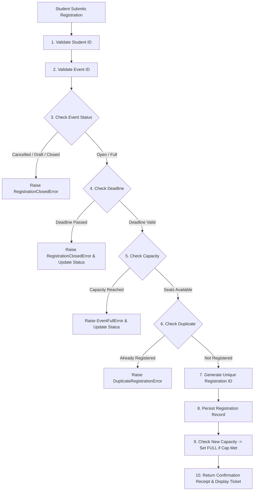

# Campus Event Management & Feedback Analyzer 🎓

> **“Manage Events. Connect Students. Analyze Participation & Feedback in Real Time.”**  
> *A Centralized Campus Event Management & Feedback Analyzer System developed as an industry-standard MCA Capstone Project.*

[](https://www.python.org/)
[](https://streamlit.io/)
[](https://pandas.pydata.org/)
[](https://matplotlib.org/)
[](#system-architecture)
[](#automated-testing)

---

## 📖 Table of Contents
1. [Project Overview](#-project-overview)
2. [Key Highlights & Innovation](#-key-highlights--innovation)
3. [System Architecture](#-system-architecture)
4. [Project Directory Structure](#-project-directory-structure)
5. [User Roles & Functional Capabilities](#-user-roles--functional-capabilities)
6. [Smart Registration Pipeline](#-smart-registration-pipeline)
7. [Analytical Engines (Pandas + NumPy)](#-analytical-engines-pandas--numpy)
8. [Event Performance Score Algorithm](#-event-performance-score-algorithm)
9. [Data Visualizations Suite (Bar, Histogram, Donut & Ranked Graphs)](#-data-visualizations-suite)
10. [Real-Time Movable Feedback Analyzer](#-real-time-movable-feedback-analyzer)
11. [Installation & Execution Guide](#-installation--execution-guide)
12. [Access Credentials](#-access-credentials)
13. [Automated Testing](#-automated-testing)
14. [Institutional Report Generation](#-institutional-report-generation)
15. [Future Scalability Roadmap](#-future-scalability-roadmap)

---

## 🌟 Project Overview

**Campus Event Management & Feedback Analyzer** is an enterprise-grade university web platform engineered to eliminate paper-based registrations, uncoordinated announcements, and unquantified event outcomes across higher-education institutions. 

Unlike conventional academic CRUD assignments, **Campus Event Management & Feedback Analyzer** is constructed with an enterprise **Clean Layered Architecture** separating presentation, application services, domain entities, and data persistence. It features an automated **10-step smart registration gatekeeper**, a **post-event review and rating mechanism**, an empirical **multi-factor Event Performance Score (0–100)**, an interactive **Visualizations Gallery** (featuring bar charts, frequency histograms, dual donut graphs, and benchmark matrices), and a **Real-Time Movable Feedback Analyzer** powered by **Plotly** and **Streamlit**.

---

## 🚀 Key Highlights & Innovation

* **Multi-Tier Separation of Concerns**: Zero business logic inside UI controllers; domain rules live strictly within service and model classes.
* **10-Step Smart Registration Engine**: Dynamic seat validation, duplicate-booking guards, registration deadline enforcements, and automated event state changes (`Open` $\rightarrow$ `Full` $\rightarrow$ `Completed` $\rightarrow$ `Closed`).
* **Multi-Factor Event Performance Score**: Combines seat capacity utilization (40%), student review scores (40%), and feedback response engagement (20%) into a normalized 0–100 indicator with performance tiers.
* **Mathematical & Statistical Rigor**: Computes arithmetic mean, median, standard deviation ($\sigma$), variance ($\sigma^2$), minimum, maximum, and interquartile range (IQR) for student satisfaction scores.
* **Full Data Visualizations Suite**: 8 publication-grade visualization routines including horizontal bar charts, rating frequency histograms, dual donut & bar charts, grouped capacity graphs, and performance score matrices.
* **Real-Time Movable Feedback Analyzer**: Movable and interactive charts (pan by dragging, scroll to zoom, hover for real-time tooltips) that synchronize dynamically when filtering by event, rating, or sentiment.
* **Institutional Audit Reports**: One-click generation of `.txt` audit reports and `.csv` datasets stored automatically in `reports/generated_reports/`.

---

## 🏗️ System Architecture

```text
┌────────────────────────────────────────────────────────┐
│             Presentation Layer (Streamlit)             │
│        app.py  │  views/admin/*  │  views/student/*     │
└───────────────────────────┬────────────────────────────┘
                            │ Calls
┌───────────────────────────▼────────────────────────────┐
│            Application & Service Layer                 │
│  EventService │ StudentService │ RegistrationService   │
│         FeedbackService │ AuthService                  │
└───────────────────────────┬────────────────────────────┘
                            │ Enforces
┌───────────────────────────▼────────────────────────────┐
│            Domain & Business Logic Layer               │
│   Event │ Student │ Registration │ Feedback Models     │
│       utils/validators.py │ utils/exceptions.py        │
└───────────────────────────┬────────────────────────────┘
                            │ Queries / Saves
┌───────────────────────────▼────────────────────────────┐
│            Data Access Layer (Repository Pattern)       │
│ BaseRepository[T] │ EventRepo │ StudentRepo │ RegRepo  │
└───────────────────────────┬────────────────────────────┘
                            │ Thread-Safe I/O
┌───────────────────────────▼────────────────────────────┐
│             Storage (CSV / Future SQL Engine)          │
│ events.csv │ students.csv │ registrations.csv │ fbk.csv│
└────────────────────────────────────────────────────────┘
```

> **Database Portability:** Because the data access layer relies on `BaseRepository[T]`, the file-based CSV backend can be switched to PostgreSQL or MySQL with SQLAlchemy simply by providing a new repository implementation without modifying a single service, validator, or UI page.

---

## 📂 Project Directory Structure

```text
Campus Event Management & Feedback Analyzer/
│
├── app.py                          # Streamlit master application & role-based router
├── config.py                       # Global configuration, constants, weights & paths
├── requirements.txt                # Production dependencies (Streamlit, Pandas, NumPy, Matplotlib, Plotly)
├── README.md                       # Comprehensive technical documentation
├── PBL_REPORT.md                   # Academic PBL Project Viva & Thesis Report
├── .gitignore                      # Git exclusion rules
│
├── models/                         # Pure domain dataclasses
│   ├── __init__.py
│   ├── event.py                    # Event domain model
│   ├── student.py                  # Student domain model (with SHA-256 passwords)
│   ├── registration.py             # Event booking entity
│   └── feedback.py                 # Student evaluation entity
│
├── repositories/                   # Data Access Layer (Repository Pattern)
│   ├── __init__.py
│   ├── base_repository.py          # Generic thread-safe CSV base repository
│   ├── event_repository.py         # Event query and persistence
│   ├── student_repository.py       # Student lookup and unique constraints
│   ├── registration_repository.py  # Active bookings and capacity lookups
│   └── feedback_repository.py      # Review records and student history
│
├── services/                       # Application & Business Logic Layer
│   ├── __init__.py
│   ├── event_service.py            # Event scheduling, capacity sync, state machine
│   ├── student_service.py          # Student lifecycle, profiling, validation
│   ├── registration_service.py     # 10-step smart booking pipeline
│   ├── feedback_service.py         # Post-event review enforcement
│   └── auth_service.py             # Session authentication & hashing
│
├── analytics/                      # Analytical Engines (Pandas + NumPy)
│   ├── __init__.py
│   ├── event_analytics.py          # Capacity and event distribution stats
│   ├── participation_analytics.py  # Attendance, department, and course breakdowns
│   └── feedback_analytics.py       # NumPy statistical metrics & Performance Scores
│
├── visualization/                  # Data Visualization Engine (Matplotlib & Plotly)
│   ├── __init__.py
│   └── charts.py                   # 8 publication-grade chart routines & byte exporters
│
├── components/                     # Reusable UI Blocks
│   ├── __init__.py
│   ├── ui_helpers.py               # Custom CSS, hero banners, KPI cards, status badges
│   └── auth_ui.py                  # Login forms, user session widgets, logout controls
│
├── views/                          # Modular Presentation Pages
│   ├── __init__.py
│   ├── admin/
│   │   ├── dashboard_view.py       # Command Center KPI dashboard & activity feeds
│   │   ├── events_view.py          # Event scheduling, editing, and status management
│   │   ├── students_view.py        # Student enrollment and dossier records
│   │   ├── registrations_view.py   # Live booking and attendance check-in roster
│   │   ├── analytics_view.py       # Visualizations, Statistical Analysis & Feedback Analyzer
│   │   └── reports_view.py         # Formal report generation and export hub
│   └── student/
│       ├── dashboard_view.py       # Personalized student portal & enrolled passes
│       ├── browse_view.py          # Event discovery and instant enrollment
│       ├── my_events_view.py       # Active passes and cancellations
│       └── feedback_view.py        # Review submissions for completed events
│
├── utils/                          # Common Utilities
│   ├── __init__.py
│   ├── constants.py                # Enums: Categories, Statuses, Departments, Rating Labels
│   ├── exceptions.py               # Custom hierarchy of domain exceptions
│   ├── helpers.py                  # ID generators, date parsers, password hashes
│   ├── validators.py               # Strict input and format validators
│   └── seed_data.py                # Realistic sample data generator (40 students, 15 events, 38 reviews)
│
├── data/                           # Persistent CSV data storage
│   ├── events.csv
│   ├── students.csv
│   ├── registrations.csv
│   └── feedback.csv
│
├── reports/                        # Report Archive Directory
│   └── generated_reports/
│
└── tests/                          # Automated Unit Test Suite
    ├── __init__.py
    ├── test_events.py              # Event validation & CRUD tests
    ├── test_students.py            # Student validation & duplicate tests
    ├── test_registrations.py       # Smart registration & capacity tests
    └── test_feedback.py            # Rating constraints & feedback tests
```

---

## 👥 User Roles & Functional Capabilities

### 👑 Administrator Role
* **Command Center Dashboard:** Dynamic KPI metrics, top-performing event spotlights, real-time activity feeds.
* **Event Management:** Schedule new events, modify parameters, monitor capacity in real-time, cancel events, or mark them completed.
* **Student Directory:** Search by department/course/semester, enroll new students with duplicate protection, inspect student participation dossiers.
* **Registration & Attendance Roster:** Check ticket status, mark attendance on event day, manage booking cancellations.
* **Visualizations & Statistical Analysis:** Toggle between the comprehensive **All Visualizations Gallery** and single chart deep-dives; review descriptive statistical metrics (mean, median, IQR, variance, std dev).
* **Feedback Analyzer:** Inspect qualitative student reviews, filter by event/rating/sentiment, view real-time movable Plotly charts, and export filtered feedback to CSV.
* **Event Performance Scoring:** View multi-criteria performance scores and tiers for all events with CSV export.
* **Report Generation:** Export comprehensive text audit logs and CSV records with one click.

### 🎓 Student Role
* **Personal Portal:** View enrolled event passes, attended history, pending review alerts, and recent comments.
* **Discover Events:** Browse campus happenings with search filters, capacity progress meters, and countdowns.
* **Smart Booking:** Instant one-click registration with real-time feedback (capacity checks, deadline checks, duplicate guards).
* **Booking Management:** Review confirmed tickets with unique Ticket IDs or withdraw to release seats for other students.
* **Quality Feedback:** Evaluate completed events using 1–5 star ratings and detailed observations (only for events attended).

---

## ⚡ Smart Registration Pipeline

The registration subsystem enforces an uncompromising 10-step verification flow:



---

## 🧮 Analytical Engines (Pandas + NumPy)

### 1. Pandas Aggregation Engine
* Performs multi-table joins between `registrations.csv`, `students.csv`, and `events.csv`.
* Computes department-wise enrollment percentages, category distributions, and venue utilization rates.

### 2. NumPy Mathematical Statistics
Numerical metrics are calculated directly on student rating arrays:
* **Arithmetic Mean ($\mu$):** $\mu = \frac{1}{N}\sum_{i=1}^N x_i$
* **Median (50th Percentile):** Robust middle value resilient to outliers.
* **Sample Standard Deviation ($\sigma$):** $\sigma = \sqrt{\frac{1}{N}\sum_{i=1}^N (x_i - \mu)^2}$
* **Variance ($\sigma^2$):** Measure of rating dispersion.
* **Quantiles & Interquartile Range (IQR):** $IQR = Q_3 - Q_1$, measuring the spread of the middle 50% of student feedback.

---

## 🏆 Event Performance Score Algorithm

The **Event Performance Score (EPS)** is an objective composite indicator on a normalized 0 to 100 scale:

$$\text{EPS} = \left( 0.40 \times S_{\text{capacity}} \right) + \left( 0.40 \times S_{\text{rating}} \right) + \left( 0.20 \times S_{\text{engagement}} \right)$$

Where:
1. **Capacity Score ($S_{\text{capacity}}$):**
   $$S_{\text{capacity}} = \min\left(1.0, \frac{\text{Registered Participants}}{\text{Maximum Seat Capacity}}\right) \times 100$$
2. **Rating Score ($S_{\text{rating}}$):**
   $$S_{\text{rating}} = \left(\frac{\text{Average Student Rating}}{5.0}\right) \times 100$$
3. **Engagement Score ($S_{\text{engagement}}$):**
   $$S_{\text{engagement}} = \min\left(1.0, \frac{\text{Number of Reviews}}{\text{Registered Participants}}\right) \times 100$$

### Performance Tiers
* 🟢 **Top Performer:** $\text{EPS} \ge 70.0$ (High turnout, stellar student satisfaction, strong feedback engagement)
* 🟡 **Average Performer:** $40.0 \le \text{EPS} < 70.0$ (Moderate participation or average ratings)
* 🔴 **Needs Improvement:** $\text{EPS} < 40.0$ (Low attendance or low satisfaction; requires review)

---

## 📊 Data Visualizations Suite

The platform provides 8 publication-grade visualization routines in `visualization/charts.py`, accessible through an interactive **All Visualizations Gallery** and a **Single Chart Deep-Dive** inspector:

| Chart Type | Name | Description |
|---|---|---|
| 📊 **Bar Chart** | Event Participation | Top events ranked by confirmed student registrations |
| 📶 **Histogram Graph** | Rating Frequency Distribution | Student rating distribution from 1 Star to 5 Stars with % values |
| 📊 **Grouped Bar Graph** | Popularity vs Capacity | Side-by-side comparison of Registered Seats vs Maximum Capacity |
| 📈 **Benchmark Bar Graph** | Average Event Ratings | Event satisfaction scores with 4.0 ★ quality target benchmark line |
| 🍩 **Dual Donut & Bar Graph** | Department Engagement | Donut pie chart of department share + horizontal registration bar chart |
| 🍩 **Dual Donut & Bar Graph** | Sentiment Proportion | Donut pie chart of student sentiment + bar breakdown (Positive/Neutral/Critical) |
| 🏷️ **Categorical Bar Graph** | Category Analysis | Total registrations and average student turnout across event domains |
| 🏆 **Score Matrix Graph** | Performance Score Matrix | Multi-tier Event Performance Scores (0–100) with benchmark thresholds |

All charts feature clean layout, labeled axes, readable legends, and can be downloaded as high-resolution PNG images.

---

## 💬 Real-Time Movable Feedback Analyzer

Located within the **Analytics & Visualizations** section, the **Feedback Analyzer** provides real-time student evaluation intelligence:

1. **⚡ Real-Time Movable Charts (Plotly)**:
   - **Movable Rating Frequency Bar Chart**: 1 to 5 Stars distribution with real-time percentages. Drag to pan across axes, scroll to zoom in/out, and hover for exact metrics.
   - **Movable Sentiment Donut Graph**: Interactive breakdown of **Positive (4–5 ★)**, **Neutral (3 ★)**, and **Critical (1–2 ★)** reviews. Hover to inspect slice shares and click legend items to isolate categories.
   - **Movable Event Benchmark Horizontal Bar**: Dynamic comparative ratings benchmark across campus events with interactive hover details.
2. **Interactive Real-Time Filters**:
   - Filter by Event, Star Rating (1–5 Stars), or Sentiment category. All charts and review tables recalculate and sync in real time.
3. **Qualitative Reviews Ledger**:
   - Tabular view of verified student comments featuring Student Name, ID, Event Name, Star Rating, Sentiment badge (`🟢 Positive`, `🟡 Neutral`, `🔴 Critical`), and Submission Timestamp.
   - One-click CSV export button for filtered feedback data.

---

## 💻 Installation & Execution Guide

### Prerequisites
* Python 3.10, 3.11, 3.12, or 3.13 installed.
* Standard `pip` package manager.

### Step 1: Clone or Navigate to Directory
```bash
cd "d:\ALL PROJECTS\Campus Event Management & Feedback Analyzer"
```

### Step 2: Install Required Dependencies
```bash
pip install -r requirements.txt
```

### Step 3: Run the Application
```bash
streamlit run app.py
```
The application will launch automatically in your default browser at `http://localhost:8501`.

*(Note: On initial startup, `seed_data.py` runs automatically to populate 15 realistic events, 40 students, 140+ registrations, and 38 feedback records).*

---

## 🔑 Access Credentials

To test the application across roles:

### 👑 Administrator Account
* **Username:** `admin`
* **Password:** `Admin@123`

### 🎓 Student Accounts
* **Student ID:** `STU001` (or any from `STU001` to `STU040`)
* **Password:** `stu001@123` *(pattern: lowercase student ID + `@123`)*

---

## 🧪 Automated Testing

The codebase includes an automated unit test suite verifying business logic and custom exceptions without altering main production data.

Run the test suite:
```bash
python -m unittest discover -s tests -v
```

### Test Coverage Summary:
* ✅ `test_events.py`: Valid event creation, duplicate event prevention, date format validation, capacity limits.
* ✅ `test_students.py`: Valid profile creation, Student ID uniqueness, email uniqueness, syntax checks.
* ✅ `test_registrations.py`: Successful registration, duplicate registration rejection, full-capacity blocking, non-existent entity handling, cancellation seat restoration.
* ✅ `test_feedback.py`: Valid feedback submission, 1–5 rating boundary enforcement, duplicate review rejection, completion status requirement, unregistered student blocking.

**Result: 20 Tests Ran | 20 Passed (0 Failures, 0 Errors)**

---

## 📑 Institutional Report Generation

Administrators can generate audit-ready reports from the **Reports & Exports** tab:
1. **Event Performance & Status Report:** Summary of seat capacity, utilization %, ratings, and performance scores.
2. **Student Participation Directory:** Comprehensive roster of student enrollments and participation counts.
3. **Executive Analytics Summary:** Campus-level briefing featuring empirical statistics and KPI breakdowns.

Reports are saved to `reports/generated_reports/` in both `.txt` and `.csv` formats and can be previewed or downloaded directly from the web interface.

---

## 🔮 Future Scalability Roadmap

The platform has been deliberately structured to allow seamless extension:
* **Relational Database Migration:** Plug in an `SQLAlchemyRepository` implementing `BaseRepository[T]` for PostgreSQL or MySQL without modifying services or UI.
* **QR-Code Event Attendance:** Generate scannable QR ticket passes for check-in via mobile devices.
* **Automated E-Certificates:** Generate personalized PDF participation certificates for students marked as `Attended`.
* **AI-Powered Aspect Sentiment Analysis:** Categorize open-ended student comments into fine-grained aspects (speaker quality, venue facilities, schedule pace).
* **Predictive Event Turnout:** Train regression models on historical category, weekday, and department data to forecast student attendance.

---

## 🎓 Academic PBL Mentorship Details
* **Project Title:** Campus Event Management & Feedback Analyzer
* **Course:** Master of Computer Applications (MCA)
* **Domain:** Software Engineering, Full-Stack Python, and Data Analytics
* **Developer:** MCA PBL Student Team
* **Guide & Mentor:** Department of Computer Applications
